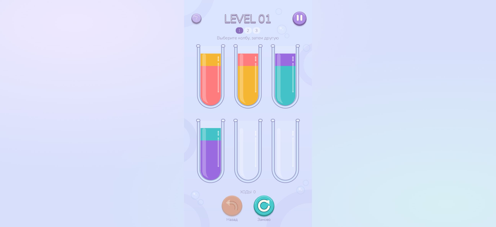
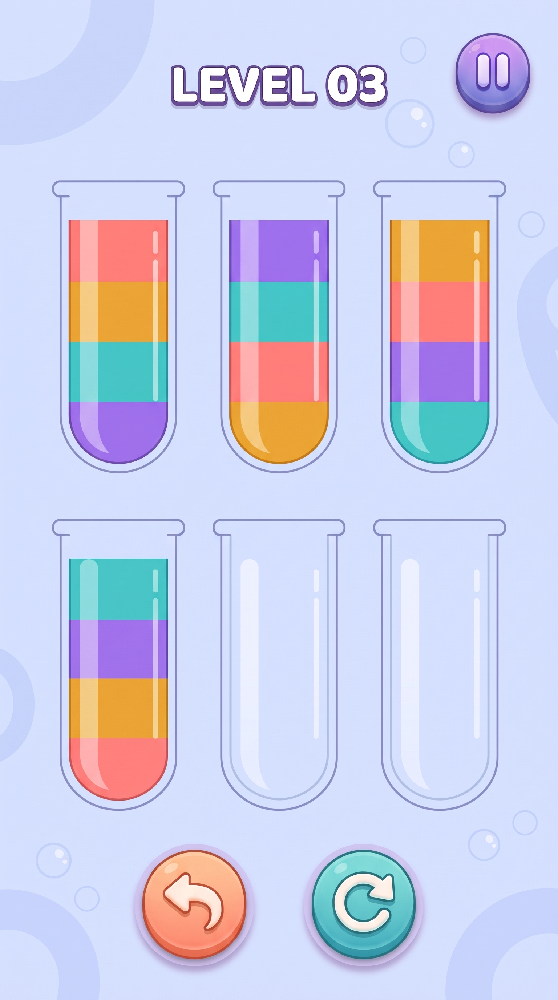

# Jelly Sort — Water Sort на Godot

Небольшая головоломка: переливайте цветные слои между колбами, пока в каждой заполненной колбе не останется один цвет. Это полноценный проект **Godot 4 / GDScript** с исходным кодом, автоматическими тестами и сборкой для браузера.

**[Играть в браузере — getcher123.github.io/water_sort](https://getcher123.github.io/water_sort/)**

Игра опубликована на GitHub Pages. Сборка и деплой автоматические: изменения в `main` проходят тесты и публикуются через [GitHub Actions](https://github.com/getcher123/water_sort/actions/workflows/pages.yml). Настройка описана в [инструкции по деплою](docs/DEPLOYMENT.md).



## Что реализовано

- Три уровня: вводный, средний и сложный; шесть колб, четыре цвета, две свободные колбы.
- Выбор источника и цели нажатием; переливание непрерывной группы верхнего цвета в пустую колбу или на тот же цвет.
- Ограничение вместимости, подсветка доступных целей и запрет повторных действий во время переливания.
- Отмена хода, перезапуск с подтверждением, пауза, правила, победа и переход на следующий уровень.
- Мышь, касания и клавиатура. Последний выбранный и пройденные уровни сохраняются по возможности; незавершённая раскладка пока не сохраняется.
- Портретный холст 720×1280 с адаптацией к окну браузера.

Это реальный Web-экспорт Godot, а не JavaScript-замена игровой логики. Жидкость — лёгкая визуальная имитация: полигоны обрезаются по внутренней маске колбы, объём задаётся площадью, поверхность при наклоне остаётся горизонтальной относительно экрана. Струя и переливание анимируются Tween. Тяжёлый физический расчёт жидкости не используется.

### Визуальное направление B1F1



Это исходный **графический концепт**, а не скриншот работающей сборки. Игровые колбы, блики, жидкость и фон воспроизведены процедурной 2D-графикой Godot.

## Управление

Нажмите **Играть**, затем колбу с жидкостью и колбу-получатель. Кнопки снизу — отмена хода и перезапуск; справа сверху — пауза; слева — правила. Номера под заголовком переключают уровни.

| Действие | Клавиши |
|---|---|
| Выбрать колбу | `1`–`6`, слева направо, сначала верхний ряд |
| Отменить ход | `Z` или `Backspace` |
| Перезапустить уровень | `R`, затем подтверждение |
| Пауза / продолжить | `Escape` или `P` |
| Открыть правила | `H` или `F1` |
| Следующий уровень после победы | `Enter` |

Для буквенных клавиш используйте английскую раскладку.

Для запуска нужны WebAssembly и **WebGL 2**. Встроенный браузер некоторых приложений может их не предоставлять — в этом случае открывайте прямую ссылку обычным браузером. Игра сообщает о недоступном WebGL и об ошибках загрузки; текст ошибки не означает, что состоялась проверка игрового экрана.

## Быстрый запуск

### В редакторе Godot

```bash
git clone https://github.com/getcher123/water_sort.git
cd water_sort
```

1. Установите стандартный **Godot 4.6.3 stable** — версия .NET не нужна.
2. В менеджере проектов выберите **Import / Импортировать** и откройте `godot/project.godot`.
3. Дождитесь импорта ресурсов и нажмите **F5** для запуска игры. **F6** запускает текущую сцену; используйте его, когда открыта `godot/scenes/main.tscn`.

Для запуска в редакторе Node.js и Web-шаблоны не нужны.

### В локальном браузере

Нужны Godot **4.6.3**, соответствующие **Web export templates 4.6.3.stable** и **Node.js 22+**; автоматическая сборка использует Node.js 24. Команда `godot` должна быть доступна в `PATH`, либо укажите установленный исполняемый файл через `GODOT_BIN`.

Из корня репозитория:

```bash
npm run build
npm run test:loader
npm run serve
```

Откройте **[http://127.0.0.1:4173/](http://127.0.0.1:4173/)**. Сервер отдаёт папку `dist` и доступен только на этом компьютере. Остановка — `Ctrl+C`. Устанавливать npm-зависимости не требуется.

Не открывайте `dist/index.html` двойным щелчком: WebAssembly и игровые ресурсы должны загружаться через HTTP/HTTPS. Подробности, настройка Windows и решение ошибок — в [RUNNING.md](docs/RUNNING.md).

## Структура репозитория

| Файл | Назначение |
|---|---|
| `godot/project.godot` | Открываемый проект Godot |
| `godot/scripts/board_model.gd` | Независимые правила и три уровня |
| `godot/scripts/main.gd` | Ввод, интерфейс, анимация и переходы |
| `godot/scripts/bottle_view.gd` | Плоская колба, маска и уровни жидкости |
| `godot/scripts/backdrop.gd` | Фон концепта B1F1 |
| `godot/web_shell.html` | Загрузка экспорта, диагностика возможностей браузера |
| `godot/tests/test_board.gd` | Автоматические проверки правил и решаемости |
| `godot/tests/test_controller.gd` | Проверки реальной сцены и Tween в Godot |
| `scripts/test-web-loader.mjs` | Изолированные тесты загрузчика, не браузерный прогон |
| `scripts/build-web.mjs` | Импорт, тесты, Web-экспорт, подготовка статических файлов |
| `scripts/test-godot.mjs` | Импорт и запуск двух наборов проверок Godot |
| `scripts/serve-web.mjs` | Локальный HTTP-сервер готового `dist` |
| `.github/workflows/pages.yml` | Проверки и публикация GitHub Pages |
| `design/B1F1-reference.jpg` | Утверждённое визуальное направление |
| `docs/` | [Запуск](docs/RUNNING.md), [архитектура](docs/ARCHITECTURE.md), [деплой](docs/DEPLOYMENT.md) |
| `qa/` | Контрольные отчёты и чек-листы |

`dist/` и кеш импорта Godot генерируются заново и не входят в исходники Git. Пути Web-ресурсов относительные, в том числе для адреса `/water_sort/`.

## Разработка и проверки

Экспортные шаблоны должны точно соответствовать версии движка; смена версии требует повторных проверок.

Из корня этого репозитория:

```bash
npm test
npm run build
npm run test:loader
```

- `npm test` импортирует ресурсы и запускает тесты модели и настоящего контроллера сцены в headless-режиме Godot.
- `npm run build` импортирует проект, проверяет игру, экспортирует Web-сборку и подготавливает `dist`.
- `npm run test:loader` проверяет загрузчик по файлам уже собранного `dist` в Node.js. Это не браузерный игровой прогон.

Локальная сборка не скачивает движок и шаблоны автоматически. В GitHub Actions необходимые инструменты подготавливает workflow.

Экспорт однопоточный, без SharedArrayBuffer и без требования COOP/COEP. Сборщик хранит runtime Godot как gzip и как резервные части. Загрузчик восстанавливает исходные байты и проверяет размер и SHA-256 до передачи движку; код движка при этом не переписывается. Первичная загрузка требует около 10 MB при поддержке распаковки gzip и около 38 MB на резервном пути; последующие загрузки зависят от кеша браузера. Подробнее — в [описании архитектуры](docs/ARCHITECTURE.md).

## Границы проверки

Результаты контрольной сборки и первого деплоя от 7 ноября 2026 года:

| Набор | Результат |
|---|---|
| Модель, правила и решаемость | 3473 проверки, 0 ошибок |
| Контроллер Godot и Tween-анимации | 512 проверок в чистом CI / 513 локально, 0 ошибок |
| Web-загрузчик | 14 сценариев, 260 проверок, 0 ошибок |
| GitHub Actions | Сборка из исходников и деплой успешны |
| Настоящий браузер Chrome | Первый уровень пройден за 6 ходов, переход на второй подтверждён |

Разница в одну проверку контроллера связана с сохранением существующего файла прогресса: локально он восстанавливается, в чистом CI удаляется только тестовый файл. Ошибок нет в обоих режимах.

В опубликованной игре проверены отрисовка Godot/WebGL 2, мышь и клавиатура, разрешённое и запрещённое переливание, отмена, пауза/возобновление, подтверждённый перезапуск, победа на первом уровне и переход на второй. В консоли проверенной сессии предупреждений и ошибок не зафиксировано. [Отчёт и скриншоты публикации](qa/pages-release.md), актуальное состояние — [state.md](state.md).

Headless-тесты и браузерная проверка учитываются отдельно. Все три уровня пройдены автоматическими тестами реального контроллера; в браузере вручную пройден первый. Физический телефон, реальные touch-жесты и разные мобильные браузеры ещё не проверялись. Историческое ограничение прежнего облачного браузера без WebGL 2 не относится к успешно проверенной сессии Chrome.

Реальный Android APK, Lumeriq SDK, аналитика, реклама, платежи, звук, магазин и публикация в App Store / Google Play в этот веб-прототип не входят. Игра работает без игрового сервера, учётной записи и платных API. Web-деплой не является проверкой мобильной SDK-интеграции.

## Лицензии и первичные материалы

- [Godot 4.6.3](https://godotengine.org/download/archive/4.6.3-stable/) — движок, MIT; [лицензия движка](godot/assets/Godot-LICENSE.txt) и [уведомления компонентов](godot/assets/Godot-COPYRIGHT.txt) копируются в `dist`.
- Nunito — [SIL Open Font License](godot/assets/Nunito-OFL.txt); шрифт из [официального каталога Google Fonts](https://github.com/google/fonts/tree/main/ofl/nunito).
- [Официальный Web-экспорт Godot 4.6](https://docs.godotengine.org/en/4.6/tutorials/export/exporting_for_web.html).
- Графический концепт B1F1 создан ранее по запросу пользователя; текущая игровая графика воспроизведена процедурно, без вырезания целого игрового экрана из картинки.

Уведомления о лицензиях зависимостей сами по себе не устанавливают лицензию на весь проект или графический концепт.
