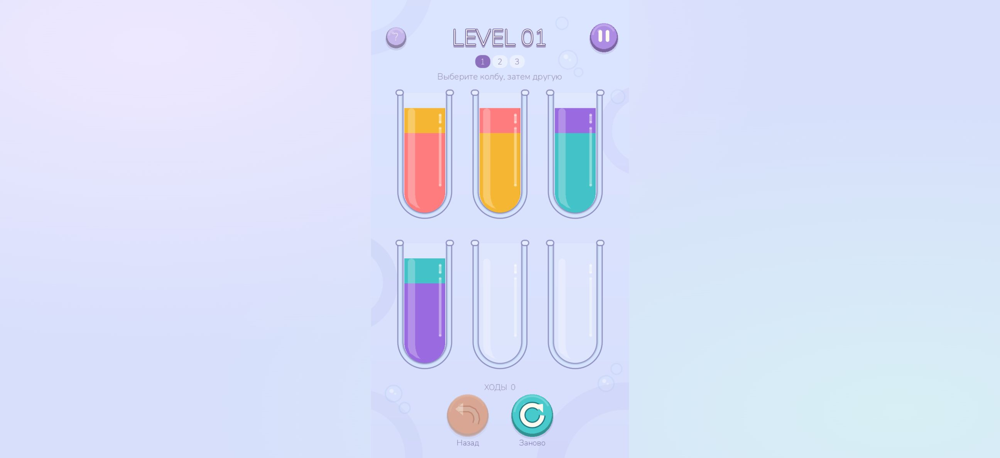
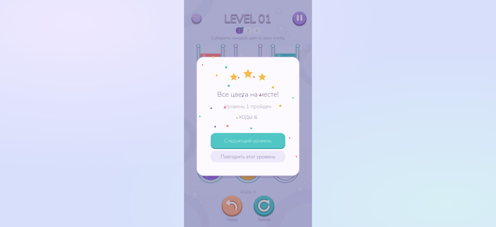

# GitHub Pages — проверка публикации

Дата: 7 ноября 2026 года.

- Игра: https://getcher123.github.io/water_sort/
- Исходники: https://github.com/getcher123/water_sort
- Проверенная игровая версия: `58a049b5f777898c7363be189b4c961d7c8f3f2e`.
- Первый успешный workflow: https://github.com/getcher123/water_sort/actions/runs/42397252718

## Сборка из исходников

GitHub Actions выполнил оба задания — **Build and test Godot Web export** и **Deploy to GitHub Pages** — с результатом success. Godot 4.6.3 и экспортные шаблоны скачаны из официального release; SHA-256 обоих архивов проверены до распаковки. Сборка выполнялась на GitHub-hosted Ubuntu 24.04, а не на ноутбуке пользователя.

| Набор | Результат |
|---|---|
| Игровая модель | 3 473 проверки, 0 ошибок |
| Реальная main.tscn, ввод, Tween и три решения | 512 проверок в чистом CI, 0 ошибок |
| Повторный локальный controller test | 513 проверок, 0 ошибок |
| Web-loader | 14 сценариев, 260 проверок, 0 ошибок |
| Web export / upload / deploy | Успешно |

Разница 512/513 определяется веткой восстановления прогресса в `test_controller.gd`: при наличии исходного файла выполняются две проверки восстановления, при его отсутствии — одна проверка удаления только созданного тестом файла.

## Публичные файлы

Получены настоящие ответы публичного хостинга:

- HTML, `index.js`, `index.pck` и `runtime-manifest.json` доступны.
- `engine.wasm.gz`: HTTP 200, `Content-Type: application/gzip`, **без Content-Encoding**.
- Получено 9 504 022 bytes gzip; размер и SHA-256 совпадают с опубликованным манифестом.
- HTML SHA-256: `b54cce2778230c1058c6a11f9d1059847d43b9005820421a07df9eeb850758d8`.
- Gzip SHA-256: `f3620f31e114f61d84b127f705c35e20c9cf0d7b8a812b9a7df0b730aaecf656`.
- PCK первого CI-экспорта: 191 332 bytes, SHA-256 `1e8d019da7faee37c82e9780adf70be6c47f6865f420615a8887a5a52d25da77`.

Хеш PCK относится к конкретному экспорту, а не является обещанием побайтовой воспроизводимости между рабочими каталогами Godot. Исходники игры и версия движка закреплены в коммите и workflow.

## Настоящий браузерный прогон

Проверена опубликованная HTTPS-страница в подключённом Chrome с настоящим движком Godot/WebGL 2. JavaScript-модель или mock Engine для этого прогона не использовались.

| Действие | Наблюдение |
|---|---|
| Нажать «Играть» | Загрузчик скрывается, отображается шесть колб и интерфейс уровня 1 |
| Перелить из первой в пятую мышью | Жёлтый слой перемещается, счётчик становится 1 |
| Отмена клавишей Z | Восстанавливаются исходная раскладка и 0 ходов |
| Недопустимый ход в полную колбу | Ходы и жидкость не меняются, появляется обратная связь |
| Пауза и Escape для возврата | Видно модальное окно, затем возвращается игра |
| Перезапуск с подтверждением | Видно «Начать заново?», после «Да, заново» поле и счётчик сброшены |
| Пройти уровень клавишами 1–6 | Победа на первом уровне за 6 ходов |
| Нажать «Следующий уровень» | Уровень 2, счётчик 0 |
| Проверить консоль этой сессии | Полученный список warn/error пуст |

Путь решения в нумерации интерфейса: **1→5, 2→1, 2→5, 3→2, 4→3, 2→4**.

### Игровой экран

### Победа

## Что ещё не проверялось

- Физический телефон и реальные touch-жесты.
- Safari/Firefox и мобильные WebView.
- Все три уровня вручную в браузере; автоматический Godot-контроллер прошёл все три.
- Android APK/AAB, Kotlin bridge и реальный Lumeriq SDK.

Эти ограничения не означают неуспешный Pages-деплой, но не позволяют объявлять весь мобильный продукт готовым.
